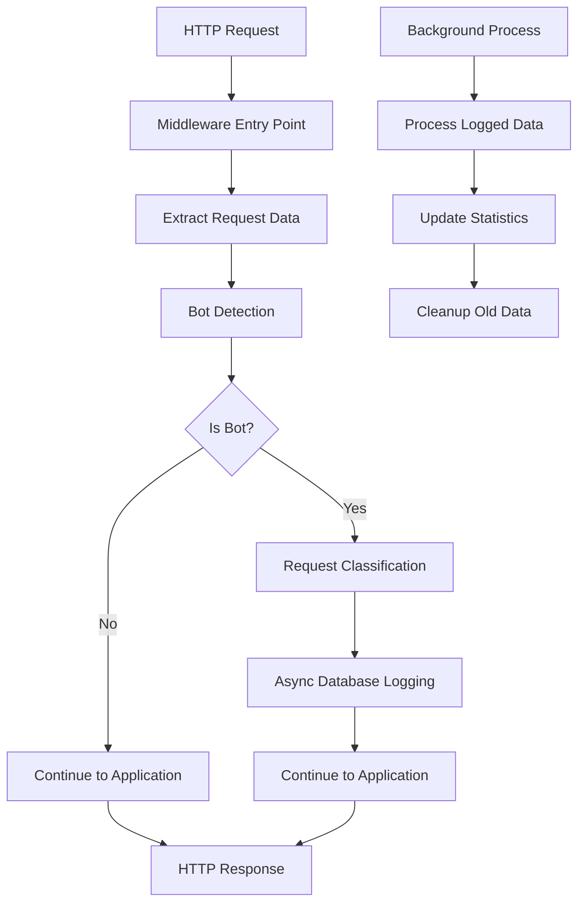

# Architecture Documentation - AI Bot Visit Tracking Tool

This document provides a comprehensive overview of the system architecture, design patterns, and technical implementation details of the AI Bot Visit Tracking Tool.

## 🏗️ System Overview

The AI Bot Visit Tracking Tool is designed as a modular, multi-language middleware solution that can be integrated into existing web applications to detect, classify, and track AI bot visits.

### Core Principles

- **Language Agnostic**: Consistent functionality across Node.js, Python, and PHP
- **Framework Flexible**: Easy integration with popular web frameworks
- **Database Independent**: Support for SQLite, MySQL, and PostgreSQL
- **Performance Focused**: Asynchronous processing and optimized queries
- **Extensible**: Configurable patterns and classification rules

## 🔧 Architecture Components

### 1. Core Components

```
┌─────────────────────────────────────────────────────────────┐
│                    Web Application                          │
├─────────────────────────────────────────────────────────────┤
│                 AI Bot Tracker Middleware                   │
│  ┌─────────────┐  ┌─────────────┐  ┌─────────────────────┐ │
│  │ Bot         │  │ Request     │  │ Database            │ │
│  │ Detector    │  │ Classifier  │  │ Manager             │ │
│  └─────────────┘  └─────────────┘  └─────────────────────┘ │
├─────────────────────────────────────────────────────────────┤
│                    Database Layer                           │
│         SQLite / MySQL / PostgreSQL                        │
└─────────────────────────────────────────────────────────────┘
```

### 2. Component Responsibilities

#### Bot Detector
- **Purpose**: Identify AI bots from HTTP requests
- **Input**: User-Agent strings, IP addresses, request headers
- **Output**: Bot identification result with confidence score
- **Features**:
  - Pattern-based user-agent matching
  - IP range validation
  - Custom bot pattern support
  - Caching for performance

#### Request Classifier
- **Purpose**: Categorize bot requests as indexing or retrieval
- **Input**: URL patterns, headers, request metadata
- **Output**: Classification result with confidence score
- **Features**:
  - URL pattern analysis
  - Header inspection
  - Request frequency analysis
  - Referer validation

#### Database Manager
- **Purpose**: Handle all database operations
- **Input**: Bot visit data, configuration settings
- **Output**: Stored data, statistics, exported reports
- **Features**:
  - Multi-database support
  - Schema management
  - Asynchronous logging
  - Data cleanup and archival

## 🔄 Request Processing Flow



### Detailed Flow Steps

1. **Request Interception**: Middleware captures incoming HTTP request
2. **Data Extraction**: Extract relevant data (User-Agent, IP, headers, URL)
3. **Bot Detection**: Check if request originates from an AI bot
4. **Classification**: If bot detected, classify request type
5. **Async Logging**: Queue data for background database insertion
6. **Request Continuation**: Allow request to proceed to application
7. **Background Processing**: Process queued data asynchronously
8. **Statistics Update**: Update aggregated statistics
9. **Cleanup**: Remove old data based on retention policies

## 🗄️ Database Schema Design

### Entity Relationship Diagram

```
┌─────────────────┐    ┌─────────────────┐    ┌─────────────────┐
│   bot_visits    │    │   bot_stats     │    │   bot_config    │
├─────────────────┤    ├─────────────────┤    ├─────────────────┤
│ id (PK)         │    │ id (PK)         │    │ id (PK)         │
│ timestamp       │    │ date            │    │ key             │
│ ip_address      │    │ bot_name        │    │ value           │
│ bot_name        │    │ total_visits    │    │ created_at      │
│ page_url        │    │ indexing_visits │    │ updated_at      │
│ headers (JSON)  │    │ retrieval_visits│    └─────────────────┘
│ classification  │    │ unique_ips      │
│ user_agent      │    │ unique_pages    │
│ referer         │    │ created_at      │
│ request_method  │    │ updated_at      │
│ response_status │    └─────────────────┘
│ response_time   │
│ created_at      │
└─────────────────┘
```

### Table Descriptions

#### bot_visits
- **Purpose**: Store individual bot visit records
- **Indexes**: timestamp, bot_name, ip_address, page_url
- **Partitioning**: By date for large datasets
- **Retention**: Configurable (default 30 days)

#### bot_stats
- **Purpose**: Store aggregated daily statistics
- **Indexes**: date, bot_name
- **Updates**: Real-time via triggers or batch processing
- **Retention**: Long-term (1+ years)

#### bot_config
- **Purpose**: Store dynamic configuration settings
- **Usage**: Runtime configuration without code changes
- **Examples**: Custom patterns, feature flags, thresholds

## 🏛️ Design Patterns

### 1. Strategy Pattern (Bot Detection)

```javascript
// Abstract strategy
class BotDetectionStrategy {
    detect(request) {
        throw new Error('Must implement detect method');
    }
}

// Concrete strategies
class UserAgentStrategy extends BotDetectionStrategy {
    detect(request) {
        return this.matchUserAgent(request.userAgent);
    }
}

class IPRangeStrategy extends BotDetectionStrategy {
    detect(request) {
        return this.matchIPRange(request.ip);
    }
}

// Context
class BotDetector {
    constructor() {
        this.strategies = [
            new UserAgentStrategy(),
            new IPRangeStrategy()
        ];
    }
    
    detect(request) {
        return this.strategies.some(strategy => 
            strategy.detect(request)
        );
    }
}
```

### 2. Observer Pattern (Event Handling)

```javascript
class BotTracker {
    constructor() {
        this.observers = [];
    }
    
    addObserver(observer) {
        this.observers.push(observer);
    }
    
    notifyObservers(event, data) {
        this.observers.forEach(observer => 
            observer.handle(event, data)
        );
    }
    
    onBotDetected(botData) {
        this.notifyObservers('bot_detected', botData);
    }
}

class StatisticsObserver {
    handle(event, data) {
        if (event === 'bot_detected') {
            this.updateStatistics(data);
        }
    }
}
```

### 3. Factory Pattern (Database Connections)

```javascript
class DatabaseFactory {
    static create(config) {
        switch (config.type) {
            case 'sqlite':
                return new SQLiteDatabase(config);
            case 'mysql':
                return new MySQLDatabase(config);
            case 'postgresql':
                return new PostgreSQLDatabase(config);
            default:
                throw new Error(`Unsupported database type: ${config.type}`);
        }
    }
}
```

### 4. Singleton Pattern (Configuration)

```javascript
class Configuration {
    constructor() {
        if (Configuration.instance) {
            return Configuration.instance;
        }
        
        this.settings = this.loadSettings();
        Configuration.instance = this;
    }
    
    static getInstance() {
        return new Configuration();
    }
}
```

## 🚀 Performance Optimizations

### 1. Asynchronous Processing

```javascript
class AsyncLogger {
    constructor() {
        this.queue = [];
        this.processing = false;
        this.batchSize = 100;
        this.flushInterval = 5000; // 5 seconds
        
        setInterval(() => this.flush(), this.flushInterval);
    }
    
    log(data) {
        this.queue.push(data);
        
        if (this.queue.length >= this.batchSize) {
            this.flush();
        }
    }
    
    async flush() {
        if (this.processing || this.queue.length === 0) {
            return;
        }
        
        this.processing = true;
        const batch = this.queue.splice(0, this.batchSize);
        
        try {
            await this.database.insertBatch(batch);
        } catch (error) {
            // Handle error, possibly re-queue
            console.error('Batch insert failed:', error);
        } finally {
            this.processing = false;
        }
    }
}
```

### 2. Caching Strategy

```javascript
class CacheManager {
    constructor() {
        this.cache = new Map();
        this.ttl = 300000; // 5 minutes
    }
    
    get(key) {
        const item = this.cache.get(key);
        
        if (!item) return null;
        
        if (Date.now() > item.expiry) {
            this.cache.delete(key);
            return null;
        }
        
        return item.value;
    }
    
    set(key, value) {
        this.cache.set(key, {
            value,
            expiry: Date.now() + this.ttl
        });
    }
}
```

### 3. Database Optimization

#### Indexing Strategy
```sql
-- Primary indexes for fast lookups
CREATE INDEX idx_visits_timestamp ON bot_visits(timestamp);
CREATE INDEX idx_visits_bot_name ON bot_visits(bot_name);
CREATE INDEX idx_visits_ip ON bot_visits(ip_address);

-- Composite indexes for common queries
CREATE INDEX idx_visits_bot_date ON bot_visits(bot_name, DATE(timestamp));
CREATE INDEX idx_visits_classification ON bot_visits(classification, timestamp);

-- Partial indexes for specific use cases
CREATE INDEX idx_visits_recent ON bot_visits(timestamp) 
WHERE timestamp > NOW() - INTERVAL '7 days';
```

#### Query Optimization
```sql
-- Efficient statistics query
SELECT 
    bot_name,
    COUNT(*) as total_visits,
    COUNT(DISTINCT ip_address) as unique_ips,
    COUNT(DISTINCT page_url) as unique_pages,
    SUM(CASE WHEN classification = 'indexing' THEN 1 ELSE 0 END) as indexing_visits,
    SUM(CASE WHEN classification = 'retrieval' THEN 1 ELSE 0 END) as retrieval_visits
FROM bot_visits 
WHERE timestamp >= ? AND timestamp <= ?
GROUP BY bot_name
ORDER BY total_visits DESC;
```

## 🔒 Security Considerations

### 1. Input Validation

```javascript
class InputValidator {
    static validateIP(ip) {
        const ipv4Regex = /^(\d{1,3}\.){3}\d{1,3}$/;
        const ipv6Regex = /^([0-9a-fA-F]{1,4}:){7}[0-9a-fA-F]{1,4}$/;
        
        return ipv4Regex.test(ip) || ipv6Regex.test(ip);
    }
    
    static sanitizeUserAgent(userAgent) {
        return userAgent
            .replace(/[<>]/g, '') // Remove potential XSS
            .substring(0, 500);    // Limit length
    }
    
    static validateURL(url) {
        try {
            new URL(url);
            return url.length <= 2048; // Reasonable URL length
        } catch {
            return false;
        }
    }
}
```

### 2. SQL Injection Prevention

```javascript
class DatabaseManager {
    async logVisit(data) {
        const query = `
            INSERT INTO bot_visits 
            (timestamp, ip_address, bot_name, page_url, headers, classification)
            VALUES (?, ?, ?, ?, ?, ?)
        `;
        
        return this.db.execute(query, [
            data.timestamp,
            data.ipAddress,
            data.botName,
            data.pageUrl,
            JSON.stringify(data.headers),
            data.classification
        ]);
    }
}
```

### 3. Rate Limiting

```javascript
class RateLimiter {
    constructor() {
        this.requests = new Map();
        this.windowSize = 3600000; // 1 hour
        this.maxRequests = 1000;
    }
    
    isAllowed(ip) {
        const now = Date.now();
        const windowStart = now - this.windowSize;
        
        if (!this.requests.has(ip)) {
            this.requests.set(ip, []);
        }
        
        const ipRequests = this.requests.get(ip);
        
        // Remove old requests
        while (ipRequests.length > 0 && ipRequests[0] < windowStart) {
            ipRequests.shift();
        }
        
        if (ipRequests.length >= this.maxRequests) {
            return false;
        }
        
        ipRequests.push(now);
        return true;
    }
}
```

## 🔧 Configuration Management

### 1. Hierarchical Configuration

```javascript
class ConfigurationManager {
    constructor() {
        this.config = this.loadConfiguration();
    }
    
    loadConfiguration() {
        const defaults = require('./config/defaults.json');
        const environment = process.env.NODE_ENV || 'development';
        const envConfig = require(`./config/${environment}.json`);
        const userConfig = this.loadUserConfig();
        
        return {
            ...defaults,
            ...envConfig,
            ...userConfig,
            ...this.loadEnvironmentVariables()
        };
    }
    
    loadEnvironmentVariables() {
        return {
            database: {
                type: process.env.DB_TYPE,
                host: process.env.DB_HOST,
                port: parseInt(process.env.DB_PORT),
                database: process.env.DB_NAME,
                username: process.env.DB_USER,
                password: process.env.DB_PASS
            },
            logging: {
                level: process.env.LOG_LEVEL,
                file: process.env.LOG_FILE
            }
        };
    }
}
```

### 2. Dynamic Configuration Updates

```javascript
class DynamicConfig {
    constructor(databaseManager) {
        this.db = databaseManager;
        this.cache = new Map();
        this.refreshInterval = 60000; // 1 minute
        
        setInterval(() => this.refresh(), this.refreshInterval);
    }
    
    async get(key, defaultValue = null) {
        if (this.cache.has(key)) {
            return this.cache.get(key);
        }
        
        const value = await this.db.getConfig(key);
        this.cache.set(key, value || defaultValue);
        
        return value || defaultValue;
    }
    
    async set(key, value) {
        await this.db.setConfig(key, value);
        this.cache.set(key, value);
    }
    
    async refresh() {
        const configs = await this.db.getAllConfigs();
        this.cache.clear();
        
        configs.forEach(config => {
            this.cache.set(config.key, config.value);
        });
    }
}
```

## 📊 Monitoring and Observability

### 1. Metrics Collection

```javascript
class MetricsCollector {
    constructor() {
        this.metrics = {
            requests_processed: 0,
            bots_detected: 0,
            database_operations: 0,
            errors: 0,
            response_times: []
        };
    }
    
    incrementCounter(metric) {
        this.metrics[metric] = (this.metrics[metric] || 0) + 1;
    }
    
    recordResponseTime(time) {
        this.metrics.response_times.push(time);
        
        // Keep only last 1000 measurements
        if (this.metrics.response_times.length > 1000) {
            this.metrics.response_times.shift();
        }
    }
    
    getMetrics() {
        const responseTimes = this.metrics.response_times;
        
        return {
            ...this.metrics,
            avg_response_time: responseTimes.length > 0 
                ? responseTimes.reduce((a, b) => a + b) / responseTimes.length 
                : 0,
            p95_response_time: this.percentile(responseTimes, 0.95),
            p99_response_time: this.percentile(responseTimes, 0.99)
        };
    }
    
    percentile(arr, p) {
        if (arr.length === 0) return 0;
        
        const sorted = [...arr].sort((a, b) => a - b);
        const index = Math.ceil(sorted.length * p) - 1;
        
        return sorted[index];
    }
}
```

### 2. Health Checks

```javascript
class HealthChecker {
    constructor(databaseManager) {
        this.db = databaseManager;
    }
    
    async checkHealth() {
        const checks = {
            database: await this.checkDatabase(),
            memory: this.checkMemory(),
            disk: await this.checkDisk()
        };
        
        const overall = Object.values(checks).every(check => check.status === 'healthy');
        
        return {
            status: overall ? 'healthy' : 'unhealthy',
            timestamp: new Date().toISOString(),
            checks
        };
    }
    
    async checkDatabase() {
        try {
            await this.db.query('SELECT 1');
            return { status: 'healthy', message: 'Database connection OK' };
        } catch (error) {
            return { status: 'unhealthy', message: error.message };
        }
    }
    
    checkMemory() {
        const usage = process.memoryUsage();
        const threshold = 1024 * 1024 * 1024; // 1GB
        
        return {
            status: usage.heapUsed < threshold ? 'healthy' : 'warning',
            message: `Memory usage: ${Math.round(usage.heapUsed / 1024 / 1024)}MB`,
            details: usage
        };
    }
}
```

## 🔄 Deployment Architecture

### 1. Single Instance Deployment

```
┌─────────────────────────────────────┐
│           Load Balancer             │
└─────────────────┬───────────────────┘
                  │
┌─────────────────▼───────────────────┐
│        Web Application              │
│  ┌─────────────────────────────┐    │
│  │   AI Bot Tracker            │    │
│  │   Middleware                │    │
│  └─────────────────────────────┘    │
└─────────────────┬───────────────────┘
                  │
┌─────────────────▼───────────────────┐
│           Database                  │
│      (SQLite/MySQL/PostgreSQL)     │
└─────────────────────────────────────┘
```

### 2. Multi-Instance Deployment

```
┌─────────────────────────────────────┐
│           Load Balancer             │
└─────┬───────────────────────┬───────┘
      │                       │
┌─────▼─────┐           ┌─────▼─────┐
│  App       │           │  App      │
│  Instance  │           │  Instance │
│  1         │           │  2        │
└─────┬─────┘           └─────┬─────┘
      │                       │
      └─────┬───────────┬─────┘
            │           │
    ┌───────▼───┐   ┌───▼────────┐
    │ Database  │   │ Redis      │
    │ Cluster   │   │ Cache      │
    └───────────┘   └────────────┘
```

### 3. Microservices Architecture

```
┌─────────────────────────────────────┐
│              API Gateway            │
└─────┬───────────────────────┬───────┘
      │                       │
┌─────▼─────┐           ┌─────▼─────┐
│  Bot      │           │ Analytics │
│  Detection│           │ Service   │
│  Service  │           │           │
└─────┬─────┘           └─────┬─────┘
      │                       │
      └─────┬───────────┬─────┘
            │           │
    ┌───────▼───┐   ┌───▼────────┐
    │ Message   │   │ Database   │
    │ Queue     │   │ Service    │
    └───────────┘   └────────────┘
```

This architecture documentation provides a comprehensive understanding of the system design, enabling developers to effectively implement, extend, and maintain the AI Bot Visit Tracking Tool across different environments and use cases.